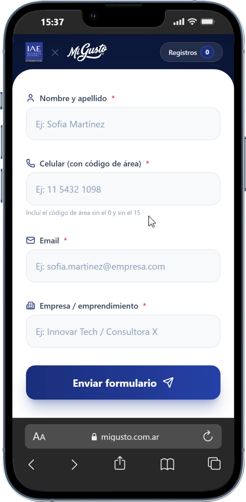
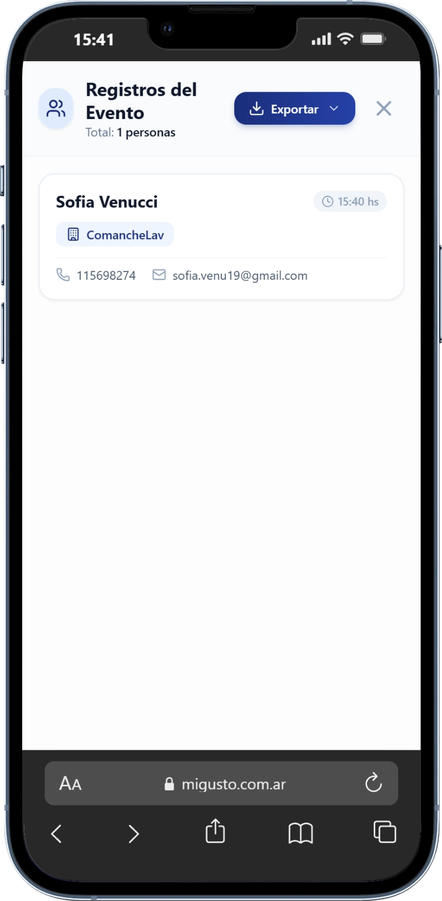

<div align="center">

# 🎓 IAE Business School x Mi Gusto 2026
### Plataforma de Registro de Participantes y Captura de Leads

Plataforma web *mobile-first* de alto rendimiento diseñada para la captación, sincronización en tiempo real y gestión ágil de participantes durante el evento anual IAE 2026.

[](https://migusto.com.ar/IAE2026/)
[](https://react.dev/)
[](https://www.typescriptlang.org/)
[](https://vitejs.dev/)
[](https://tailwindcss.com/)
[](https://pnpm.io/)

</div>

---

## 📸 Galería de Vistas Previas

<div align="center">
  <table>
    <tr>
      <td align="center" valign="top">
        
        <br />
        <sub><b>Formulario de Registro</b></sub>
      </td>
      <td align="center" valign="top">
        
        <br />
        <sub><b>Panel de Registros / Confirmación</b></sub>
      </td>
    </tr>
  </table>
  <p><em>Diseño mobile-first optimizado para interacción ágil en smartphones</em></p>
</div>

---

## ✨ Características Principales

- 📱 **Mobile-First UX/UI**: Diseño optimizado para celulares con estética institucional de IAE Business School y Mi Gusto.
- ⚡ **Offline-First Resilience**: Los datos se almacenan de inmediato en `localStorage`, garantizando cero pérdida de información ante cortes o mala señal durante el evento.
- 📊 **Sincronización en la Nube**: Envío asíncrono y en segundo plano hacia **Google Sheets** mediante Google Apps Script Webhook.
- 🔐 **Panel de Registros Integrado**: Modal administrativo en vivo con contador en tiempo real, búsqueda de participantes y métricas de registros.
- 📥 **Exportación Multi-formato**:
  - **Excel (`.xlsx`)**: Generación de planillas estructuradas listas para CRM y análisis.
  - **PDF Institucional**: Reporte exportable con tablas estilizadas mediante `jsPDF` y `autoTable`.
- 🛡️ **Validaciones en Tiempo Real**: Comprobación estricta de nombres, teléfonos (con código de área) y correos electrónicos.
- 🎉 **Feedback Visual**: Microinteracciones dinámicas y animación de celebración con confeti tras cada registro exitoso.

---

## 🛠️ Stack Tecnológico

| Capa | Tecnología |
| :--- | :--- |
| **Frontend Framework** | [React 19](https://react.dev/) |
| **Tipado & Lenguaje** | [TypeScript](https://www.typescriptlang.org/) |
| **Estilos & Diseño** | [Tailwind CSS v4](https://tailwindcss.com/) |
| **Bundler & Tooling** | [Vite 8](https://vitejs.dev/) & [oxlint](https://oxc.rs/) |
| **Gestor de Paquetes** | [pnpm v11](https://pnpm.io/) |
| **Procesamiento de Datos** | [SheetJS (xlsx)](https://sheetjs.com/) & [jsPDF](https://github.com/parallax/jsPDF) |
| **Iconografía & Efectos** | [Lucide React](https://lucide.dev/) & [Canvas Confetti](https://www.npmjs.com/package/canvas-confetti) |
| **Backend Serverless** | [Google Apps Script](https://developers.google.com/apps-script) (Webhook API) |

---

## ⚙️ Conexión con Google Sheets

La aplicación envía los registros en tiempo real a una hoja de cálculo mediante un Webhook de Google Apps Script:

1. Crea una nueva planilla en [Google Sheets](https://sheets.google.com).
2. Dirígete a **Extensiones > Apps Script**.
3. Copia y pega el código incluido en [google-apps-script.js](./google-apps-script.js).
4. Haz clic en **Implementar > Nueva implementación**:
   - **Tipo**: Aplicación web (*Web App*).
   - **Ejecutar como**: Yo (*tu cuenta*).
   - **Quién tiene acceso**: Cualquier usuario (*Anyone*).
5. Copia la URL generada y agrégala a tu archivo `.env` local:
   ```env
   VITE_GOOGLE_SHEETS_URL=https://script.google.com/macros/s/TU_WEBHOOK_ID/exec
   ```

---

## 🚀 Instalación y Desarrollo Local

### Prerrequisitos
- [Node.js](https://nodejs.org/) (versión 20 o superior)
- [pnpm](https://pnpm.io/) (versión 10 u 11)

### Pasos

1. **Clonar el repositorio**:
   ```bash
   git clone https://github.com/MiGustoDev/IAE-x-Mi-Gusto-2026.git
   cd IAE-x-Mi-Gusto-2026
   ```

2. **Instalar dependencias**:
   ```bash
   pnpm install
   ```

3. **Configurar variables de entorno**:
   ```bash
   cp .env.example .env
   # Completa VITE_GOOGLE_SHEETS_URL con tu webhook
   ```

4. **Iniciar en modo desarrollo**:
   ```bash
   pnpm run dev
   ```

5. **Compilar para producción**:
   ```bash
   pnpm run build
   ```

---

## 📁 Estructura del Proyecto

```text
├── public/
│   ├── screenshots/          # Capturas de pantalla para documentación
│   ├── .htaccess             # Reglas Apache para subdirectorios y SPA
│   └── *.png, *.svg          # Logos institucionales y favicons
├── src/
│   ├── assets/               # Recursos estáticos de la aplicación
│   ├── components/
│   │   ├── AdminModal.tsx    # Modal con listado de registros y exportación (Excel/PDF)
│   │   └── RegistrationForm.tsx # Formulario principal reactivo
│   ├── utils/
│   │   └── storage.ts        # Persistencia local (localStorage) y helpers
│   ├── App.tsx               # Componente principal y cabecera
│   ├── main.tsx              # Punto de entrada de la aplicación
│   └── types.ts              # Tipos e interfaces de TypeScript
├── google-apps-script.js     # Webhook serverless para Google Sheets
├── vite.config.ts            # Configuración de Vite y subdirectorio base
└── package.json              # Scripts y dependencias
```

---

## 📄 Licencia

Desarrollado para el evento corporativo **IAE Business School x Mi Gusto 2026**.
